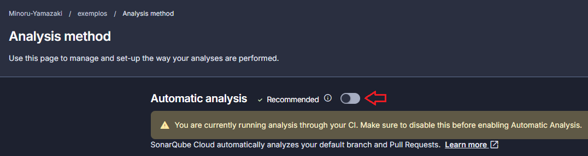
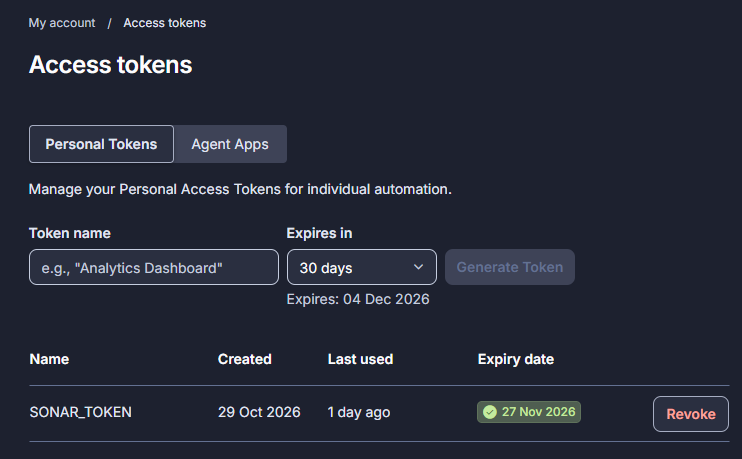
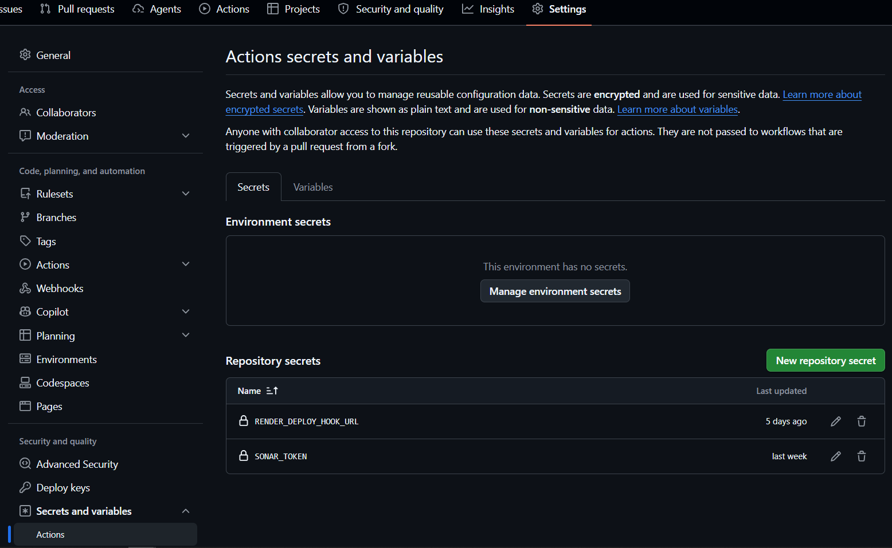

# 1 - Redis

<details>
<summary>Cache</summary>

### *dependencies:*
```
<dependency>
    <groupId>org.springframework.boot</groupId>
    <artifactId>spring-boot-starter-data-redis</artifactId>
</dependency>
```
### *properties:*
```
#spring.redis.host=localhost
#spring.redis.port=6379
#spring.redis.password=
```
### *config:*
```java
@Configuration
@EnableCaching
public class RedisConfig {

    @Bean
    public RedisTemplate<String, Object> redisTemplate(RedisConnectionFactory connectionFactory) {

        RedisTemplate<String, Object> template = new RedisTemplate<>();
        template.setConnectionFactory(connectionFactory);

        var keySerializer = new StringRedisSerializer();
        var valueSerializer = GenericJacksonJsonRedisSerializer.builder()
                .build();

        template.setKeySerializer(keySerializer);
        template.setValueSerializer(valueSerializer);

        template.setHashKeySerializer(keySerializer);
        template.setHashValueSerializer(valueSerializer);

        return template;
    }

    // Configuração de cache
    @Bean
    public CacheManager cacheManager(RedisConnectionFactory connectionFactory) {
        RedisCacheConfiguration config = RedisCacheConfiguration.defaultCacheConfig()
                .entryTtl(Duration.ofMinutes(5)) // Define o TTL para 5 minutos
                .disableCachingNullValues();

        return RedisCacheManager.builder(connectionFactory)
                .cacheDefaults(config)
                .build();
    }

}
```

### Implementar *Serializable*
```java
import java.io.Serializable;

public class ProfessorDTO implements Serializable {

    private String nome;
    private String cpf;
    private List<DisciplinaDTO> disciplinas;
    
    // getters and setters

}
```

### Anotar método com *@Cacheable*
```java
public class ProfessorServiceImpl implements ProfessorService {

    // atributos

    @Cacheable(value = "professores", key = "#id")
    public ProfessorDTO buscarPorId(Long id) {
        // processamento
    }
    
}
```

### Remover Cache com *@CacheEvict*
```java
@CacheEvict(value = "professores", key = "#id")
public void excluir(Long id) {
    repository.deleteById(id);
}
```

### Atualizar Cache com *@CachePut*
```java
@CachePut(value = "professores", key = "#dto.id")
public ProfessorDTO atualizar(ProfessorDTO dto) {
    // atualizar professor
}
```

### Docker: Execute o Redis em um contêiner *Docker*
```bash
docker run --name redis -p 6379:6379 -d redis
```

### Resumo
 - O Redis como cache ajuda a reduzir a latência e a carga no banco de dados.
 - Anotação @Cacheable: Salva automaticamente o resultado do método no cache Redis.
 - Ferramentas como @Cacheable, @CacheEvict, e @CachePut permitem um controle completo do cache.
 - TTL (Time-to-Live): Garante que o cache expira após um tempo configurado.

</details>

# 2 - Application Event

<details>
<summary>Publish Event</summary>

Crie um evento que estenda de *ApplicationEvent* e no construtor passe uma classe que deseje recuperar.
```java
public class LimparCache extends ApplicationEvent {

    public LimparCache(DomainCache cache) {
        super(cache);
    }

    public DomainCache getCache(){
        return (DomainCache) this.getSource();
    }

}
```

Publique o evento no fluxo onde desejar que ocorra a alteração.
```java
public class SalvarDisciplina {
    
    public Disciplina execute(Disciplina disciplina){
        // código ocultado
        applicationEventPublisher.publishEvent(new LimparCache(
                new DomainCache("professores", disciplina.getProfessorId().toString())));    
        return disciplina;
    }

}
```
Crie um *Listener* que reagirá com o evento:
```java
public class CacheService {
    
    @EventListener
    public void on(LimparCache event){
        // código para limpar o cache
    }

}
```

</details>

# 3 - CI/CI - GitHub Actions + SonarQube + Render
<details>
    <summary>Entendendo o código da pipeline</summary>

### 3.1 Nome do workflow

```yaml
name: CI/CD - GitHub Actions + Sonar + Render
```   
É o nome que aparecerá na interface do GitHub.
Ele ajuda a identificar a automação na aba Actions do repositório.

### 3.2. Eventos que iniciam a execução
```yaml
on:
  push:
    branches:
      [feature, release, master]

  pull_request:
    branches:
      [feature, release, master]
```   
Esse trecho define quando o workflow será executado.
Temos dois eventos. \
**Evento 1: "push"**:
Quando alguém envia commits diretamente paras as branch *feature, release, master*, o pipeline é iniciado.
Por exemplo:
```bash
git add .
git commit -m "feat: adiciona cadastro de produtos"
git push origin feature/#7git-hub-actions
```  

**Evento 2 "pull_request":** \
Quando alguém abre ou atualiza um Pull Request direcionado as branchs *feature, release, master*, o pipeline também é iniciado. \
Isso é importante porque permite verificar se as alterações passam nos testes antes de serem incorporadas à branch principal. \
Observe uma distinção importante: configurar o workflow para executar em Pull Requests não impede, por si só, que alguém incorpore código sem passar pelos testes. Para impor essa regra, precisamos configurar as proteções da branch no GitHub.

### 3.3. Definindo um job
```yaml
jobs:
    build:
        name: Compilar e testar e analisar
        runs-on: ubuntu-latest
```  

Aqui definimos um job chamado build.
O atributo:
```yaml
runs-on: ubuntu-latest
```  

determina o ambiente no qual o job será executado. \
Nesse caso, o GitHub disponibilizará um runner com Ubuntu. \
Pense nele como uma máquina que recebe o código, prepara o ambiente e executa os comandos do pipeline. \
O runner não precisa ser o mesmo computador utilizado para desenvolver a aplicação.

### 3.4. Baixando o código
```yaml
- name: Baixar código
  uses: actions/checkout@v4
  with:
    fetch-depth: 0
```  


O runner precisa acessar os arquivos do seu projeto para compilá-lo e executar os testes. \
A Action actions/checkout realiza o checkout do repositório no ambiente de execução. \
Sem essa etapa, o job normalmente não terá o código do projeto disponível no diretório de trabalho. \
O campo uses indica que estamos utilizando uma Action reutilizável, em vez de executar diretamente um comando de shell.

fetch-depth: 0 → Faz o checkout do histórico completo do Git. Isso ajuda o SonarQube a identificar corretamente informações sobre o histórico e as alterações do código.

### 3.5. Configurando o Java
```yaml
- name: Configurar Java
  uses: actions/setup-java@v4
  with:
    distribution: temurin
    java-version: '21'
    cache: maven
```  


Essa etapa prepara o ambiente Java.
Cada configuração tem uma função:

| Configuração  |	Função
|---------------|---------------
| distribution: | temurin	Escolhe a distribuição Eclipse Temurin do Java
| java-version: | '21'	Define a versão do Java
| cache: maven  | Habilita o cache de dependências do Maven

O cache pode reduzir o tempo das próximas execuções ao evitar downloads desnecessários de dependências.
Isso não significa que o Maven deixará de verificar ou resolver as dependências necessárias.

### 3.6. Validar formatação Java
```yaml
- name: Validar formatação Java
  run: mvn -B spring-javaformat:validate
```  
Verifica se o código-fonte Java segue os padrões de formatação estabelecidos pelo projeto, garantindo consistência, legibilidade e padronização do código.

Adicionado trecho no pom:
```xml
<build>
    <plugins>
        <plugin>
            <groupId>io.spring.javaformat</groupId>
            <artifactId>spring-javaformat-maven-plugin</artifactId>
            <version>0.0.43</version>
        </plugin>
    </plugins>
</build>
```

### 3.7. Executar testes e análise SonarQube
```yaml
  - name: Executar testes e análise SonarQube
    run: >
      mvn -B verify
      org.sonarsource.scanner.maven:sonar-maven-plugin:sonar
      -Dsonar.qualitygate.wait=true
    env:
      SONAR_TOKEN: ${{ secrets.SONAR_TOKEN }}
      GITHUB_TOKEN: ${{ secrets.GITHUB_TOKEN }}
```
Executa os testes automatizados e a análise estática do código-fonte, verificando o funcionamento da aplicação e identificando possíveis bugs, vulnerabilidades e problemas de qualidade. Também verifica se o código atende aos critérios de qualidade definidos no SonarQube.
```bash
 mvn -B verify
```
O comando verify executa todas as fases anteriores a ele, incluindo:

| Fase     | Responsabilidade 
|----------|---------------
| validate | Verifica se o projeto está estruturado corretamente. 
| compile  | Compila o código-fonte principal. 
| test	   | Executa os testes unitários. 
| package  | Empacota a aplicação, normalmente gerando um JAR. 
| verify   | Executa verificações adicionais configuradas no projeto.

Uma observação importante: essas são as principais fases do ciclo de vida. O Maven também possui outras fases intermediárias, como process-resources, test-compile e prepare-package.

```bash
 org.sonarsource.scanner.maven:sonar-maven-plugin:sonar
```
Esse comando executa o Maven Plugin do SonarScanner. \
Sua função é analisar o código-fonte e enviar os resultados para o SonarQube Cloud.

```bash
 -Dsonar.qualitygate.wait=true
```
Essa opção faz o scanner aguardar o resultado do Quality Gate. Se a avaliação terminar com falha, a execução do scanner também falhará. \
O Quality Gate precisa estar configurado no SonarQube Cloud de acordo com os critérios que você deseja aplicar ao projeto. \
A referência técnica está na documentação do [SonarScanner para Maven.](https://docs.sonarsource.com/sonarqube-cloud/analyzing-source-code/scanners/sonarscanner-for-maven)
```yaml
 env:
  SONAR_TOKEN: ${{ secrets.SONAR_TOKEN }}
```
Disponibiliza o token para autenticação do scanner sem expor seu valor no arquivo de configuração.

----------------------------------------------------------------------------------------------

Adicionado trecho no pom:
```xml
<properties>
    <!-- Sonar -->
    <sonar.host.url>https://sonarcloud.io</sonar.host.url>
    <sonar.organization>minoru-yamazaki</sonar.organization>
    <sonar.projectKey>Minoru-Yamazaki_exemplos</sonar.projectKey>
    <sonar.token>token</sonar.token>
</properties>
```
Essas propriedades identificam o destino da análise. O token de autenticação continuará sendo fornecido pelo GitHub Actions.

```xml
<properties>
    <sonar.coverage.exclusions>
        **/config/**,
        **/dto/**,
        **/entity/**,
        **/exception/**,
        **/filter/**,
        **/interceptor/**,
        **/*Application.java
    </sonar.coverage.exclusions>
</properties>
```
Existem duas propriedades que não devem ser confundidas:
- **sonar.exclusions**: remove os arquivos da análise do Sonar.
- **sonar.coverage.exclusions**: mantém os arquivos na análise, mas não os considera no cálculo de cobertura de testes.
A recomendação é usar *sonar.coverage.exclusions* quando quiser apenas desconsiderar DTOs, entidades e classes de configuração da cobertura, mas ainda queira que o Sonar analise possíveis problemas de qualidade nesses arquivos.

```xml
<build>
    <plugins>
        <plugin>
            <groupId>org.jacoco</groupId>
            <artifactId>jacoco-maven-plugin</artifactId>
            <version>0.8.14</version>
            <executions>
                <execution>
                    <goals>
                        <goal>prepare-agent</goal>
                    </goals>
                </execution>

                <execution>
                    <id>report</id>
                    <phase>verify</phase>
                    <goals>
                        <goal>report</goal>
                    </goals>
                </execution>
            </executions>
        </plugin>
    </plugins>
</build>
```
Configuração do JaCoCo para gerar cobertura de testes no Sonar

### 3.8. Deploy no Render
```yaml
  - name: Deploy no Render
    if: github.event_name == 'push' && github.ref == 'refs/heads/master'
    env:
      RENDER_DEPLOY_HOOK_URL: ${{ secrets.RENDER_DEPLOY_HOOK_URL }}
    run: |
      HTTP_STATUS=$(curl \
        --silent \
        --show-error \
        --output response.json \
        --write-out "%{http_code}" \
        --request POST \
        "$RENDER_DEPLOY_HOOK_URL")

      echo "HTTP Status: $HTTP_STATUS"
      cat response.json

      if [ "$HTTP_STATUS" -lt 200 ] || [ "$HTTP_STATUS" -ge 300 ]; then
        exit 1
      fi
```
Responsável por automatizar a implantação da aplicação no ambiente de hospedagem Render, disponibilizando uma nova versão após a conclusão bem-sucedida das etapas anteriores.

</details>
<details>
<summary>Configuração do projeto no SonarQube Cloud</summary>

Antes de modificar a pipeline, você precisa:
1. Acessar [SonarQube Cloud.](https://sonarcloud.io/projects)
2. Importar seu repositório do GitHub e configurar o projeto para análise via CI. (Desligar a análise automática).


3. Identificar a Organization Key e a Project Key do projeto. (Project → Project Information → Project Key/Organization Key)
4. Gerar um token de autenticação em My Account → Access tokens


 
Não coloque o token diretamente no pom.xml ou no arquivo YAML. Ele deve ficar armazenado nos Secrets do GitHub.
Configurar o Secret no GitHub
No seu repositório, acesse:

Settings → Secrets and variables → Actions → New repository secret



</details>

<details>
<summary>Configuração do projeto no Render</summary>

Crie o Deploy Hook no Render
1. Acesse o painel do Render: [Render Dashboard.](https://dashboard.render.com/)
2. New → Web Service → Escolher projeto GitHub
   * Language → Docker
   * Dockerfile Path → ./Dockerfile
   * Advanced → Auto-Deploy → off
   * Deploy Hook → gerar e adicionar nos secrets do GitHub 
3. Adicionar arquivo Dockerfile na raiz do projeto

Já que o projeto utiliza o Java 21 e o Render não oferece um runtime nativo para Java, é recomendado usar Dockerfile:
```bash
  # Etapa 1: compilar a aplicação
  FROM maven:3.9-eclipse-temurin-21 AS build

  WORKDIR /app

  COPY pom.xml .
  COPY src ./src

  RUN mvn -B clean package -DskipTests

  # Etapa 2: executar a aplicação
  FROM eclipse-temurin:21-jre

  WORKDIR /app

  COPY --from=build /app/target/*.jar app.jar

  EXPOSE 10000

  ENTRYPOINT ["sh", "-c", "java -Dserver.port=${PORT:-10000} -jar app.jar"]
```


</details>

# 4 - Exemplo

<details>
<summary>Clique aqui para expandir</summary>

Conteúdo

</details>